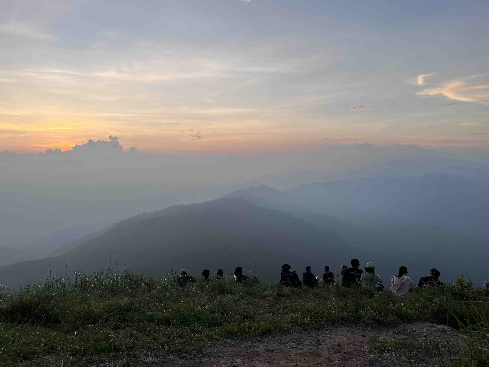

It was near dawn. While everyone was preparing their gear, I filled up my water bladder and inspected my personal gear for the last time.
Porters came to weigh shared items of all groups. After my final gear inspection, I went to the toilet to brush my teeth.
The air was filled with the scent of petrichor. I was a wee bit sleepy due to lack of sleep. We had travelled from Bangkok to Tak overnight by a rented van.
When it was dawn, we assembled in the field and got ourselves on a pickup truck. It took us around 30 minutes to the trailhead via a dirt road.
There were about a dozen people in our group.

At the beginning of the trail, there was a stream which we needed to cross. Fortunately, even though it was early October, there wasn't much rain in Tak,
so we managed to cross it easily. I unfolded my trekking poles and followed local guides. From what I heard, this trail was originally used by villagers
for foraging and herding. There was a smell of cow dung along the way. The first few kilometers weren't that elevated. It was a winding trail along a creek.
There were three checkpoints at 3rd, 6th, 9th kilometer where villagers brought a cooler box filled with various cold drinks for us to buy.
I drank a bottle of gatorade to replenish lost sweat caused by the heat. I rested there for about 10 minutes and then continued. It started getting serious.
The elevation got steeper. Along the way, we heard the sound of motorbikes used by porters to bring supplies and hikers' baggage. They used another trail parallel to ours.
I wonder how a motorbike is able to climb such a rugged and steep trail.

We arrived at 2nd checkpoint around 10am. It was more windy than at the ground level. There were many motorbikes parked there.
Because they cannot pass through the remaining segment of the trail anymore, porters must continue on foot to a campsite. There was only 3.5 km left to a campsite.
I continued on my way. I passed through a narrow ridge with cliffs on both sides. My heart was pounding from the height. The landscape was breathtaking though.
I could see a peak which we were headed for. It was enveloped by a small cloud. Much of the remaining elevation is concentrated at the last segment of the trail.
There was the toughest uphill before the 3rd checkpoint. We needed to climb rocks and tree roots. It was very demanding. My calves burnt, I stopped to catch my breath every few meters.
This hill resembles the last hill of renowned Phu Soi Dao trail. At last I arrived at the 3rd checkpoint, my guide had been already there, I stayed there for 15 minutes
then I headed to the campsite. In order to reach the campsite, I needed to walk through a banana grove where leeches reside. After spraying bug repellent,
I walked hastily through the muddy ground of the banana grove.

Finally, I arrived at the campsite at 11:30 AM. I quickly stretched my legs and calves and then took a nap. There was a light breeze.
The weather at the camp was very pleasant. Few hours passed, one by one, people trickled in.
In the late afternoon, around 16:00, everyone had arrived at the camp, so we walked a kilometer to the viewpoint to take photos.
A landscape over there was breathtaking with endless mountain ranges at the skyline.
At the end of the trail, there was a famous photo spot, a lone pine tree. It was dusk. The sky was dyed a reddish hue. A grassy hill turned golden.
We sat leisurely, watching the sun sink behind a cloud. Many people sat there doing nothing, just observing.
That moment was magical. Everyone fell silent. There was only the sound of the howling wind and the swaying grass.
I'd like to freeze that moment in time. After we had enjoyed the scenery enough, we walked back to the camp.
Our guides had prepared a hot meal. While we were having supper together, we had a few conversations to introduce ourselves.
One of my campmates went to a porter to buy a bottle of local brewed white spirit. It was strong enough to warm me up with a single shot.
Night fell and I strolled out of the camp to the clearing to view the night sky. There were plenty of stars. Nowadays, it's difficult to see them from within big cities.
I was stunned by their grandieur. I realized how our problems are insignificant when compared to majestic nature.
At last, I walked back to my tent and fell asleep due to physical tiredness.

